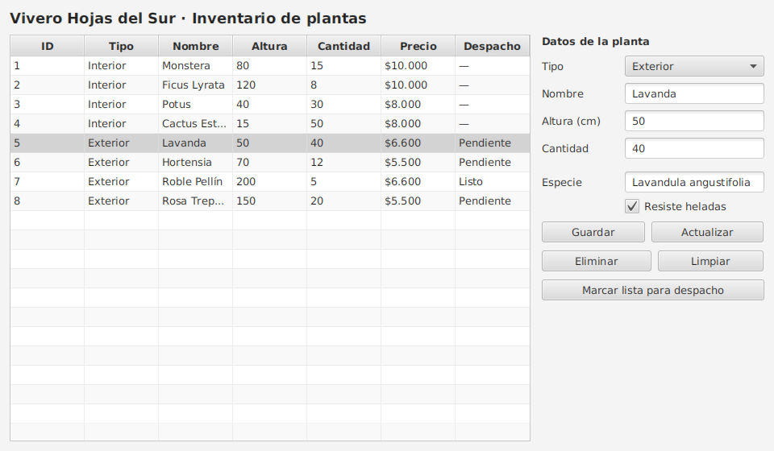

# Vivero Hojas del Sur · De archivos JSON a base de datos (DSY1102)

[](https://github.com/donkiwicl/poo_vivero_bd/actions/workflows/ci.yml)

Caso secuencial para la **Experiencia de Aprendizaje 3** de *Desarrollo Orientado a Objetos*
(semanas 13 y 14): el mismo vivero que los estudiantes ya conocen de la EP2, pero ahora sus plantas
**se guardan en MySQL** en lugar de archivos JSON.

| | |
|---|---|
| **Tecnologías** | Java 21 · Maven · MySQL 8 · MySQL Connector/J 9.7.0 · JavaFX 21.0.6 |
| **Modelo** | `Planta`, `PlantaInterior`, `PlantaExterior`, `Despachable` (el de la EP2; el único cambio es que `Planta` ahora tiene `id`) |
| **Estructura** | 7 pasos. Cada carpeta `paso-NN-…` es un proyecto **completo y ejecutable**, con su propio `README.md` que explica qué se agrega y por qué |

## Los 7 pasos

Léelos en orden: cada paso parte del código del anterior y agrega **una sola idea**.

| Paso | Tema | Qué aprende el estudiante | Material |
|:---:|---|---|---|
| [1](paso-01-sql/README.md) | **Nivelación SQL** | `CREATE TABLE`, claves, `SELECT`, `JOIN`, `GROUP BY`, `INSERT/UPDATE/DELETE` | 3.1.1 |
| [2](paso-02-conexion/README.md) | **Conectividad a la base de datos** | Driver JDBC, URL de conexión, `DriverManager`, `try-with-resources` | 3.1.2 |
| [3](paso-03-configuracion/README.md) | **Configuración de la conexión** | `db.properties`, variables de entorno, clase `DatabaseConnection`, diagnóstico de errores | 3.1.3 |
| [4](paso-04-crud-statement/README.md) | **Consultas y manipulación de datos** | `executeQuery` vs `executeUpdate`, `ResultSet` → objetos, CRUD con `Statement` | 3.1.4 |
| [5](paso-05-parametrizadas/README.md) | **Sentencias parametrizadas** | `PreparedStatement`, inyección SQL (demostrada), batch y transacciones | 3.1.5 · 3.1.6 · 3.1.7 |
| [6](paso-06-dao/README.md) | **Refactorización de la capa DAO** | Interfaz `PlantaDao`, implementación MySQL y en memoria, `PlantaRepository` | 3.2.1 · 3.2.4 |
| [7](paso-07-javafx/README.md) | **Integración con la interfaz** | `TableView` + formulario conectados al repositorio, errores en `Alert` | 3.2.2 · 3.2.3 |

El detalle de qué parte de cada PPT, guía y ejercicio cubre cada paso, y cómo encaja en las sesiones
de la guía docente, está en [`docs/MAPA_MATERIAL.md`](docs/MAPA_MATERIAL.md).



## Cómo ejecutarlo (Ubuntu)

**1. Requisitos**

```bash
sudo apt install openjdk-21-jdk maven mysql-server mysql-client
sudo systemctl start mysql
# Clave del laboratorio (la que usan las guías): root / 1234
sudo mysql -e "ALTER USER 'root'@'localhost' IDENTIFIED BY '1234'; FLUSH PRIVILEGES;"
```

¿Prefieres Docker? `docker compose up -d` levanta MySQL 8.4 con la base ya creada (puerto 3306, root / 1234).

**2. Crear la base de datos** (se puede repetir las veces que haga falta: recrea todo desde cero)

```bash
scripts/crear-bd.sh
```

**3. Ejecutar un paso**

```bash
cd paso-05-parametrizadas
mvn -q compile exec:java        # pasos 2 a 6
# o, en el paso 7:
cd paso-07-javafx && mvn javafx:run
```

En IntelliJ IDEA / PhpStorm: *File → Open* sobre la carpeta del paso (Maven la reconoce sola), JDK 21.

> La conexión se configura en `src/main/resources/db.properties` (pasos 3 a 7) o con las variables de
> entorno `VIVERO_DB_URL`, `VIVERO_DB_USUARIO`, `VIVERO_DB_CLAVE`.

## Cómo revisarlo desde el móvil

Todo el caso está pensado para leerse en la app de GitHub: los `README.md` de cada paso se ven formateados,
el código se navega por carpetas y no hace falta ejecutar nada para entender la secuencia.
Más detalles y el flujo de trabajo nube ↔ móvil ↔ Ubuntu en [`docs/COMO_TRABAJAR.md`](docs/COMO_TRABAJAR.md).

## Estructura

```
poo_vivero_bd/
├── sql/                      Esquema y datos de la base "vivero" (compartidos por todos los pasos)
├── scripts/crear-bd.sh       Crea/recrea la base de datos
├── docker-compose.yml        MySQL 8.4 listo para usar (opcional)
├── docs/                     Mapa del material, flujo de trabajo, capturas
├── paso-01-sql/              Consultas de nivelación (solo SQL)
├── paso-02-conexion/         Proyecto Maven: primera conexión
├── paso-03-configuracion/    + db.properties y DatabaseConnection
├── paso-04-crud-statement/   + modelo, ResultSet → objetos, CRUD con Statement
├── paso-05-parametrizadas/   + PreparedStatement e inyección SQL
├── paso-06-dao/              + PlantaDao, PlantaDaoMySql, PlantaDaoMemoria, PlantaRepository
└── paso-07-javafx/           + vista FXML y controlador JavaFX
```
