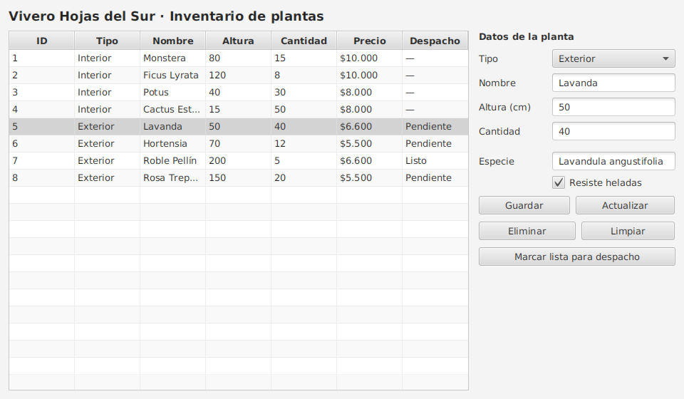

# Paso 7 · Integración de la base de datos con la interfaz JavaFX

**Material:** PPT 3.2.2 · Guía 3.2.3 · Ejercicios 3.1.7 (bloque 6) y 3.2.4 (bloque 5) · **Clases:**
[`MainController`](src/main/java/cl/duoc/vivero/controller/MainController.java) ·
[`main-view.fxml`](src/main/resources/cl/duoc/vivero/view/main-view.fxml)



## Objetivo

Conectar la tabla y el formulario de JavaFX al `PlantaRepository` del paso 6. Los paquetes `model`, `dao`, `database` y
`repository` se copian **sin tocar una línea**: lo único nuevo es la interfaz.

## Qué se agrega

| Archivo | Rol |
|---|---|
| `Launcher` · `App` | Arranque de JavaFX (igual que en la EP2) |
| `main-view.fxml` | La vista: `TableView` a la izquierda, formulario y botones a la derecha. **Sin una sola línea de SQL** |
| `MainController` | Responde a los botones, lee el formulario, llama al repositorio y refresca la tabla |

## El corazón: `ObservableList` + `TableView`

```java
private final ObservableList<Planta> datos = FXCollections.observableArrayList();
...
tabla.setItems(datos);                    // la tabla OBSERVA la lista
...
datos.setAll(repositorio.listar());      // cambia la lista → la tabla se redibuja sola
```

Después de **cada** operación (guardar, actualizar, eliminar) se vuelve a leer la base con `cargarDatos()`: la tabla siempre
muestra lo que realmente hay guardado.

## El ciclo de cada botón

| Botón | Qué hace el controlador | Qué ejecuta la base |
|---|---|---|
| (al abrir) | `cargarDatos()` | `SELECT` |
| Guardar | Lee el formulario → crea la `Planta` → `repositorio.registrar(...)` | `INSERT` |
| clic en una fila | Copia los datos de la fila al formulario | — |
| Actualizar | Crea la `Planta` modificada con el `id` de la fila elegida → `repositorio.actualizar(...)` | `UPDATE` |
| Eliminar | Pide confirmación → `repositorio.eliminar(...)` | `DELETE` |
| Marcar lista para despacho | `marcarListaParaDespacho()` → `repositorio.actualizar(...)` | `UPDATE` |

## Dos tipos de error, dos tipos de aviso

```java
try {
    accion.run();
} catch (IllegalArgumentException e) {     // el MODELO rechazó el dato (altura 999, nombre vacío...)
    → Alert de advertencia
} catch (PersistenciaException e) {        // falló la BASE DE DATOS (servidor apagado, restricción...)
    → Alert de error con el detalle
}
```

Gracias al paso 6, el controlador no importa nada de `java.sql`. Un buen ejercicio: buscar `java.sql` dentro de `controller/`.

## El desacoplamiento en una línea

```java
private final PlantaRepository repositorio = new PlantaRepository(new PlantaDaoMySql());
```

Cambiar `PlantaDaoMySql` por `PlantaDaoMemoria` hace que la aplicación funcione **sin base de datos**, y nada más se modifica.

## Cómo ejecutarlo

```bash
scripts/crear-bd.sh                 # desde la raíz, si aún no existe la base
cd paso-07-javafx
mvn javafx:run
```

Prueba esta secuencia: guardar una planta de interior → seleccionarla → cambiar la cantidad → actualizar → guardar una
de exterior → marcarla para despacho → eliminar una. Luego intenta guardar una planta con altura `999` y con la cantidad
vacía, y **apaga MySQL** para ver el aviso de error de base de datos.

## Errores frecuentes

| Situación | Causa | Revisión |
|---|---|---|
| La tabla aparece vacía | No se llamó a `cargarDatos()` o falló la consulta | Consola y `db.properties` |
| `Location is not set` / vista no encontrada | Ruta del FXML incorrecta | `App.VISTA_PRINCIPAL` y carpeta `resources/cl/duoc/vivero/view` |
| `Error: JavaFX runtime components are missing` | Se ejecutó `App` en vez de `Launcher` | Ejecutar `Launcher` o `mvn javafx:run` |
| Actualizar no cambia nada | No hay fila seleccionada | El `id` viene de la fila elegida, no del formulario |
| El estado de despacho se pierde al editar | No se conservó al reconstruir la planta | `conservarDespacho(...)` en el controlador |
| El controlador creció demasiado | Volvió a entrar lógica de datos | Moverla al repositorio / DAO |

## Para extender (opcionales)

- Búsqueda por nombre con un `TextField` (ya existe `buscarPorNombre` en el DAO).
- Mostrar el proveedor en la tabla (un `JOIN` en el DAO y un campo nuevo en el modelo).
- Un servicio intermedio entre controlador y repositorio para reglas de negocio.
- Pruebas del repositorio usando `PlantaDaoMemoria`.

## Cierre del recorrido

| | EP2 (archivos) | Este caso (base de datos) |
|---|---|---|
| Dónde se guardan los datos | `interiores.json`, `exteriores.json` | Tablas `planta` y `proveedor` |
| Quién conoce el formato | `GsonPlantaDao` | `PlantaDaoMySql` |
| Consultas | Recorrer listas en memoria | `SELECT … WHERE …` |
| Integridad | Validaciones del modelo | Validaciones del modelo **y** restricciones de la base |
| Lo que ve el controlador | `PlantaRepository` | `PlantaRepository` (misma idea, otro destino) |
